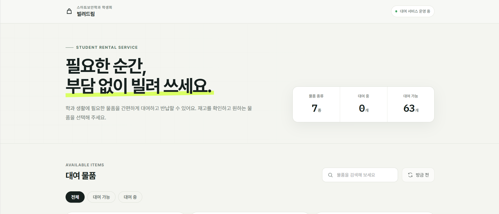
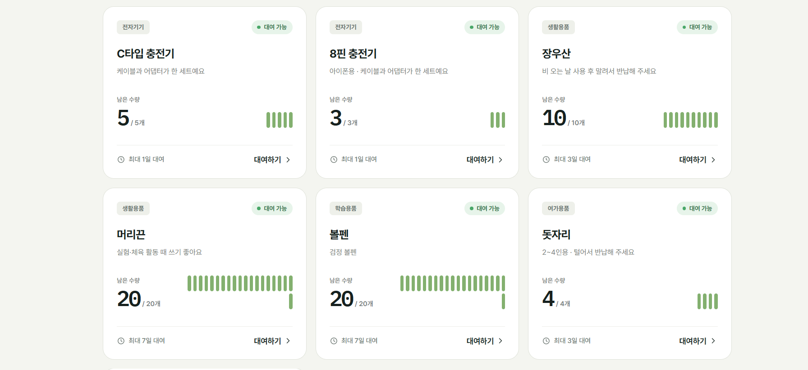
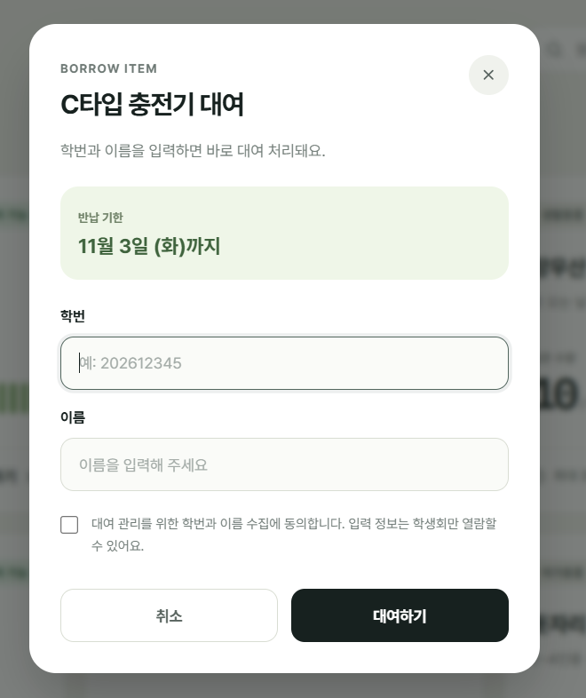

# 빌려드림 — 학생회 물품 대여 서비스

가천대학교 스마트보안학과 학생회의 공용 물품(충전기, 우산, 돗자리 등) 대여·반납을 웹으로 관리하는 서비스입니다.
학생은 로그인 없이 링크나 QR코드로 접속해 남은 수량을 확인하고 학번·이름만으로 대여·반납할 수 있으며, 학번과 이름은 학생회만 열람할 수 있습니다.

> 이 프로젝트는 AI(Claude)를 활용해 구현했습니다. 요구사항 정의, 플랫폼 선택, UI 디자인(Figma), 배포와 운영은 직접 진행했습니다.





## 해결하려는 문제

- 대여 물품에 어떤 것들이 있는지 확인하려면 학생회실에 직접 가야 했음
- 학생회실 물품의 남은 수량을 확인하려면 학생회실에 직접 가야 했음
- 누가 언제 빌렸는지, 반납 기한이 지났는지 파악하기 어려웠음

## 주요 기능

| 대상 | 기능 |
|---|---|
| 학생 | 물품별 남은 수량·대여 기간 확인, 검색·필터(대여 가능/대여 중) |
| 학생 | 학번·이름 입력과 개인정보 수집 동의 후 대여, 반납 기한 즉시 안내 |
| 학생 | 대여 때와 같은 학번·이름으로 반납 (불일치 시 거절) |
| 학생회 | 구글 시트에서 대여 기록 확인, 기한이 지난 대여는 빨간색으로 자동 표시 |
| 학생회 | 시트에서 물품명·수량·대여 기간·분류를 수정하면 사이트에 바로 반영 |
| 학생회 | 매일 아침 "기한 지남 / 오늘까지 / 내일까지" 반납 알림 메일 자동 발송 |

## 구조

```
학생 브라우저 ──(google.script.run)──▶ Apps Script 웹 앱 (Code.gs)
   Index.html                               │
   - 물품 목록·수량만 받음                  ├─ 시트 '물품'     : 물품 목록 (학생회 관리)
   - 학번·이름은 보내기만 함                └─ 시트 '대여기록' : 대여·반납 장부 (학번·이름 포함)

시간 트리거 (매일 09시) ──▶ Reminder.gs ──▶ 학생회 메일
```

| 파일 | 역할 |
|---|---|
| `Code.gs` | 웹 페이지 제공(`doGet`), 물품 현황 조회(`getStatus`), 대여(`borrow`), 반납(`returnItem`), 초기 시트 생성(`setup`) |
| `Index.html` | 학생용 화면. Figma로 디자인한 카드형 UI, 검색·필터, 대여·반납 모달 |
| `Reminder.gs` | 반납 기한 알림 메일. `installReminder`로 매일 실행 예약 |

### 데이터 구조

**물품 시트**: `ID | 물품명 | 메모 | 총수량 | 대여기간(일) | 분류`

**대여기록 시트**: `대여ID | 대여시각 | 물품ID | 물품명 | 학번 | 이름 | 반납기한 | 반납시각 | 상태(대여중/반납완료)`

남은 수량은 따로 저장하지 않고 `총수량 − 상태가 '대여중'인 기록 수`로 매번 계산합니다. 수량과 장부가 서로 어긋날 수 없게 하기 위해서입니다.

## 보안 설계

- **개인정보가 학생 화면으로 내려가지 않음**: `getStatus`는 물품별 수량만 반환합니다. 학번·이름은 시트에만 저장되고, 시트는 학생회 임원 계정에만 공유합니다.
- **입력값 서버 검증**: 학번(숫자 8~10자리)과 이름(2~20자)을 브라우저뿐 아니라 서버(`validate_`)에서도 다시 검사합니다.
- **스프레드시트 수식 삽입(CSV/Formula Injection) 방지**: `=`, `+`, `-`, `@`로 시작하는 입력은 앞에 `'`를 붙여 텍스트로 저장합니다(`safe_`). 관리자가 시트를 열 때 악성 수식이 실행되는 것을 막습니다.
- **동시 요청 처리**: 대여·반납은 `LockService`로 한 번에 하나씩 처리해, 마지막 1개를 두 사람이 동시에 빌리는 문제를 막습니다.
- **XSS 방지**: 화면에 표시하는 모든 값은 HTML 이스케이프(`esc`) 후 출력합니다.
- **본인 확인 반납**: 반납은 대여 때 입력한 학번·이름과 일치해야 처리됩니다.

### 한계

- 실명 인증이 없어 다른 사람의 학번·이름으로 대여할 수 있습니다. 학생회가 장부를 대조하는 방식으로 보완합니다.
- 웹 앱 실행 권한이 시트 소유자 계정이므로, 소유자 계정 관리가 곧 서비스 보안입니다.

## 설치 방법

1. 구글 시트를 새로 만들고 **확장 프로그램 → Apps Script**를 엽니다.
2. `Code.gs`, `Index.html`(HTML 파일 이름은 `Index`), `Reminder.gs`를 붙여넣고 저장합니다.
3. 함수 `setup`을 한 번 실행해 '물품', '대여기록' 시트를 만듭니다.
4. **배포 → 새 배포 → 웹 앱**, 실행 사용자 "나", 액세스 "모든 사용자"로 배포합니다.
5. 함수 `installReminder`를 한 번 실행해 매일 알림을 예약합니다.
6. 코드 수정 후에는 **배포 관리 → 수정 → 새 버전**으로 올려야 주소가 유지됩니다.

## 기술 스택

Google Apps Script · Google Sheets · HTML/CSS/JavaScript · Figma Make(디자인) · Claude(구현 보조)

## 진행 과정

1. claude.ai 아티팩트로 첫 버전 제작 → 학생들이 로그인과 권한 부여 없이는 쓸 수 없는 문제 확인
2. 로그인 없이 링크로 쓸 수 있는 Google Apps Script로 이전
3. Figma Make로 UI를 다시 디자인해 적용
4. 반납 기한 알림 메일 자동화 추가
5. Firebase(서버 보안 규칙, 관리자 페이지) 이전 검토 — 결제 계정 예치금과 차기 학생회 인수인계 문제로 보류

## 앞으로

- [ ] 한 학기 운영 후 사용자 수·대여 건수·연체율 정리
- [ ] 학생 피드백 반영
- [ ] 차기 학생회 인수인계 문서 작성
